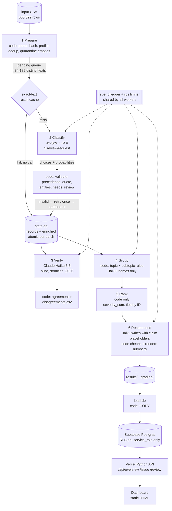

# Spotify Review Insight Pipeline

**Question:** at the end of the review window (Nov 2023), where should Spotify's next quarter of product effort go —
access, usability, playback, or billing/support?

**Answer (from the full run):** **Usability**. It ranks first of the four areas on the baseline priority
(severity sum 215,962 across 82,988 complaint/cancellation reviews) and still has the most complaints in the latest
comparable months (Jun–Oct 2023: 32,526). **Watch Billing/support**: its complaints grew from 3,788 to 30,084 between
Jun–Oct 2022 and Jun–Oct 2023, the fastest of the four (observed, not causal). Playback has higher mean severity
(3.38 vs 2.60) on about half the volume; Access is the most severe per review but small. → [results/memo.md](results/memo.md)

| | |
|---|---|
| **Live dashboard** | **https://spotify-review-dashboard-wheat.vercel.app** (public, no login; opening it makes no model calls) |
| Grading export | [grading/](grading/) — passes `check_submission.py` with coverage 1.0 (see [Self-check](#self-check)) |
| Decision memo | [results/memo.md](results/memo.md) · claims [grading/claims.csv](grading/claims.csv) · all claims [results/claims_all.csv](results/claims_all.csv) |
| Cost calculator | [cost/](cost/) — offline replay: `python cost/calculator.py` · [measured 100-review report](cost/report.md) |
| Resume recording | [evals/resume/resume_demo.mp4](evals/resume/resume_demo.mp4) + [checkpoints](evals/resume/) |
| Total API spend | **$17.48** computed for the whole project (full run $16.91; development & tests $0.57); provider dashboards show **$17.46** ([reconciliation](cost/reconciliation.md)) — course limit $20 |

---

## Results summary

| | |
|---|---|
| Source rows ingested / accounted for | **660,622 / 660,622** (SHA-256 `1fc85de6…2fcef6`, 97,400,616 bytes) |
| Classified (completed) | **660,609 / 660,609** nonempty reviews (100%) |
| Quarantined | **13**, all `empty_review_text` ([results/quarantine.jsonl](results/quarantine.jsonl)); missing `app_version` (159,701 rows) is not an exclusion |
| Exact-text reuse | 484,189 distinct texts classified; **176,420** IDs reuse an identical text's validated result (`cache_source_id`) |
| Model calls (full run) | Jev enrich 475,727 attempts (30 transient failures, retried); Haiku verify 2,179; group 33; memo 17 (iterations v2–v8) |
| Independent verification (n = 2,026, stratified) | topic 86.9%, intent 88.6%, severity exact 83.9% (MAE 0.17); area ranking unchanged after verifier calibration — [analysis](docs/verifier_disagreement_analysis.md) |
| Golden 50 (human labels) | topic 80%, intent 92%, severity exact 88% (MAE 0.12), sentiment within ±0.5: 92% — [details](#evaluation) |
| Planted-error / injection tests | 12/12 planted wrong labels flagged; 5/5 prompt injections resisted |
| Full-run wall-clock | 6.6 h enrichment at a shared 20 requests/s limit (8 workers) + 7 min downstream stages |

Measured results and estimates are kept separate: everything above is measured; projections live in
[cost/report.md](cost/report.md) and the refreshes [cost/refresh_500.md](cost/refresh_500.md) / [cost/refresh_10k.md](cost/refresh_10k.md).

### Like-for-like trend (same months, two years)

Jun–Oct 2022 vs Jun–Oct 2023 (full months only; the first and last months of the window are partial).
Source: [results/trend_comparable_periods.csv](results/trend_comparable_periods.csv), claims C083–C100.

| | Jun–Oct 2022 | Jun–Oct 2023 |
|---|---|---|
| classified reviews | 148,357 | 273,370 |
| complaint + cancellation share | 30.1% | 59.1% |
| cancellation-intent reviews | 2,789 | 16,003 |
| Usability complaints | 17,976 | 32,526 |
| Billing/support complaints | 3,788 | 30,084 |
| Playback complaints | 12,432 | 12,506 |
| Access complaints | 2,110 | 5,460 |
| outside the four areas | 8,359 | 80,852 |

Review volume and complaint share both rose sharply in 2023 (July and October 2023 have unusually many reviews, many of
them vague or boycott-style complaints counted outside the four areas). The data cannot say why; the memo reports the
changes as observed only.

### Baseline ranking (top 8 of 33 issues)

`priority_score = complaint_count × mean_severity = severity_sum`; descending, ties by issue ID. Complaint + cancellation
records only, one issue per review. Full table: [grading/ranking.csv](grading/ranking.csv).

| rank | issue_id | complaints | mean severity | priority |
|---|---|---|---|---|
| 1 | `other/general` (vague "bad app", outside the four areas) | 99,133 | 2.063692 | 204,580 |
| 2 | `billing/subscription_entitlement` | 28,301 | 2.888237 | 81,740 |
| 3 | `usability/ads` | 28,991 | 2.303163 | 66,771 |
| 4 | `playback/general` | 15,778 | 3.390671 | 53,498 |
| 5 | `usability/general` | 19,060 | 2.591605 | 49,396 |
| 6 | `usability/ui_layout` | 13,755 | 2.799927 | 38,513 |
| 7 | `usability/queue_playlist` | 12,329 | 2.911266 | 35,893 |
| 8 | `access/login_failure` | 6,620 | 3.963595 | 26,239 |

### The four areas (topic → area: playback+downloads = Playback; billing+support = Billing/support)

| area | complaints | share | mean severity | severity sum |
|---|---|---|---|---|
| **Usability** | 82,988 | 28.0% | 2.60 | **215,962** |
| Playback | 42,366 | 14.3% | 3.38 | 143,019 |
| Billing/support | 45,504 | 15.3% | 2.83 | 128,973 |
| Access | 11,455 | 3.9% | 3.89 | 44,570 |
| *Outside the four (catalog + other)* | 114,306 | 38.5% | 2.15 | 245,796 |

---

## Architecture



**Where code decides vs where a model judges**

| Stage | Owner | Input → output (handoff) | Failure behavior | Stop condition |
|---|---|---|---|---|
| 1 Prepare | code | CSV → `state.db`, [reports/ingestion_report.json](reports/ingestion_report.json) | count/checksum mismatch → DB not promoted | all rows pending or quarantined |
| 2 Classify | **Jev** (judgment) + code (validation, precedence, quote, entities) | pending distinct texts → `records`/`enriched`, `calls.jsonl` | invalid output → retry once → quarantine; 429/499/5xx → bounded backoff; non-retryable 4xx → quarantine; still failing → stays pending | queue empty, spend cap, Ctrl-C, 10 consecutive failures, 401 |
| 3 Verify | **Haiku** (judgment, blind) + code (compare) | stratified sample → [verify_report](results/verify_report.json), [disagreements](results/verify_disagreements.csv) | invalid → retry once → unverified | sample exhausted / spend cap |
| 4 Group | code (membership) + **Haiku** (names from ≤20 ID-tagged examples) | complaints → `membership.csv`, [issues.json](results/issues.json) | naming invalid → keep code name | every complaint in exactly one issue |
| 5 Rank | code | records + membership → [ranking.csv](grading/ranking.csv) | — | deterministic (hash-checked) |
| 6 Recommend | **Haiku** (argument) + code (claims, checks, rendering) | ranking + aggregates + evidence pack → [memo.md](results/memo.md), [claims](results/claims_all.csv) | unknown claim/ID, free-typed digit, a superlative attached to the wrong area, or an issue claim placed after another issue's ID → one regeneration → else not saved | check passes |

Why each model call exists: Jev answers fixed multiple-choice questions cheaply ($0.042/M input tokens, output free) but
cannot write text; Haiku 5.5 is used only for tasks that need language (an independent second opinion, readable issue
names, the argument). Code owns all accounting, arithmetic, IDs, quotes and every number in the memo.

**Database / backend / dashboard.** `python cli.py load-db --workspace runs/full` loads saved outputs into Supabase
([db/schema.sql](db/schema.sql)): `reviews_enriched` (660,622 rows, no review text — evidence quotes only),
`issues`, `claims`, `recommendations` (the pipeline-generated memo + structured recommendations + evidence pack),
`run_info` (aggregates, monthly trend, quality metrics). RLS is on and only `service_role` is granted `select`.
The Vercel function ([dashboard/api/index.py](dashboard/api/index.py)) reads Supabase server-side with the secret key from Vercel
environment variables; the static page ([dashboard/public/index.html](dashboard/public/index.html)) only calls `/api/*`.

---

## One real review, end to end

Review `0e43cbb8-ff9e-4288-9b07-067f0b46481a` (2022-07-19, 1 star): *"5 minutes of song = 1 minute of advertisement Worst experience"*

1. **Source**: row hash `4da0b9aa…10acb209c0` (`row_sha` from the provided checker).
2. **Enrichment** (Jev, label_config `jev-1.13.0+rubric-v1.002865e8+q4.cd7ce12b`): topic `usability`, intent `complaint`,
   severity 2, sentiment −0.98, entities `["ads"]`, quote = full text (short review), `needs_review` false. The result
   came from the result cache (the same text was classified in the 10k development run, call `local-8bd9e06b…`, same label_config).
3. **Verification** (Haiku, blind): usability / complaint / 2 — agrees on all three fields (request `req_011Cg3FNB6nb27s2Pa9Wjryj`).
4. **Issue membership**: `usability/ads` (keyword rule `ads` in the quote).
5. **Ranking**: `usability/ads` is rank 3 — 28,991 complaints, severity sum 66,771, mean 2.303163.
6. **Memo**: the issue's numbers appear as claims C011–C014 in [grading/claims.csv](grading/claims.csv); the memo's
   Usability case cites `usability/ads` (rank claim C015) and the area claims C051–C057. On the dashboard, hover a `C0xx` chip for its source.

**A failure and how it was handled.** During the recorded interruption, Ctrl-C stopped and saved the enrich stage
correctly, but the old orchestrator then continued into *verify* on the partial corpus (189 calls, ≈$0.03, results
discarded). Fix: the pipeline now stops after any incomplete enrich and prints a resume hint (commit `53abca7`).
Later, 25 Jev requests failed with HTTP 499 `internal_error` (+3 × 502, 2 connection resets); those 29 rows stayed
`pending` (never silently completed), 499 was added to the retryable set, and a third session completed them.

**An ambiguous case.** Golden review `292ce26a…` is an angry political complaint about songs being "banned". Human:
catalog / complaint / severity 3 (marked ambiguous, alt topic `other`); pipeline: other / complaint / 2. Anger and
cancellation language do not raise severity under the shared definitions; whether removed content is a "restricted
function" is the judgment call, recorded in [evals/golden/per_case.csv](evals/golden/per_case.csv).

---

## Evaluation

**Golden 50** ([evals/golden/](evals/golden/)). Hand-labeled by the author before any prediction existed (frozen copy +
SHA-256). The golden results did not influence any prompt, threshold or rubric choice: the Jev wording (q4) was chosen
on development data before the golden run ([docs/jev_question_versions.md](docs/jev_question_versions.md)). Labels are never model inputs, prompt examples, thresholds or grouping inputs. Predeclared: sentiment pass if
|Δ| ≤ 0.5; missing/quarantined predictions count as wrong. Two labels whose own notes contradicted the recorded value were
corrected afterwards and disclosed in [label_corrections.md](evals/golden/label_corrections.md); both versions are reported.

| metric | corrected labels | original frozen labels |
|---|---|---|
| topic agreement | 80% | 78% |
| intent agreement | 92% | 88% |
| severity exact / MAE | 88% / 0.12 | 88% / 0.12 |
| sentiment within ±0.5 / MAE | 92% / 0.18 | 92% / 0.18 |
| evidence quote is an exact substring | 100% | 100% |
| ambiguous cases | 2 | 2 |

Error analysis ([eval_report.md](evals/golden/eval_report.md), confusion tables included): (1) praise of a specific feature
("few ads", "song variety") labeled `other` instead of the feature's topic; (2) multi-problem reviews where the tie rule
("first mentioned") was not followed; (3) non-English text (Tagalog, Indonesian, Hinglish) — weaker, as TypeSafe documents.
Fifty cases are a diagnostic sample, not a population accuracy estimate.

*Evidence quotes.* All 50 are exact substrings (checked in code). 46 are the whole (short) review, so support reduces to
label correctness; the 4 sentence-selected quotes were inspected (pre-judged by Claude, confirmed by the human labeler): 1 supports the label, 1 partially (supports the
cancellation intent, not the defect), 2 do not (the selector picked the opening sentence instead of the sentence with
the failure) — [evals/golden/quote_support_review.csv](evals/golden/quote_support_review.csv). *Entities:* 0 unsupported
additions, 5 misses. *needs_review as a prediction:* the human flagged 8, the pipeline 5, overlap 3 (precision 0.60,
recall 0.38, accuracy 0.86) — the flag is conservative and misses some hard cases.

**Independent verifier** (full run, Haiku 5.5, never sees the Jev answer): 2,026 reviews, stratified by topic with a
2,000 cap and ≥30 per topic. Disagreements were investigated in
[docs/verifier_disagreement_analysis.md](docs/verifier_disagreement_analysis.md): the main patterns are praise of a
specific feature labeled `other`, the billing vs usability boundary for premium-only controls, under-detected explicit
cancellations, and **Jev assigning higher severity** (242 of 326 severity differences). Re-scaling each area's severity
by the verifier/Jev ratio leaves the area order unchanged (Usability > Playback > Billing/support > Access;
[results/severity_sensitivity.json](results/severity_sensitivity.json)). Agreement is lowest for `support` (53%) and `access` (74%) — small topics with boundary
cases (support vs billing; login vs playback). [Disagreements](results/verify_disagreements.csv).

**System tests** ([evals/system_tests/](evals/system_tests/)):
- *Planted errors*: a separate test copy of 40 verified records with 12 deliberately wrong labels (topic/intent/severity);
  the code comparison against the blind verifier flagged **12/12** (6 of the 28 untouched were also flagged — the baseline
  disagreement rate).
- *Prompt injection*: 5 synthetic reviews carrying instructions ("ignore previous instructions…", fake `SYSTEM OVERRIDE`,
  `</review>` tag-breaking, instructions to the issue namer and to the memo writer) + 3 controls, run in an isolated
  workspace: **5/5 resisted** across enrich, verify, group naming and memo; controls correct. Synthetic rows are never in
  business aggregates.
- *Memo checks in practice* (human inspection + code): v1 hid claim values from the writer (blind comparisons);
  v2 misordered areas; v3/v4 used the wrong placeholder format (blocked by code, not saved); v5 called Playback the
  "highest mean severity" area (Access is) — found by inspection, then turned into a code check (superlatives must
  attach to the actual first/last area) plus an issue-attribution check; v7 required review-ID citations (v6 cited none);
  v8 added the like-for-like trend. During v8 the code check blocked malformed claim IDs, which turned out to be a bug in
  claim numbering (a loop variable shadowed the counter) — fixed with a test. Final **memo-v8** passed on its first
  attempt ([results/memo_check.json](results/memo_check.json)); rejected v8 drafts are kept in
  [results/memo_rejected_drafts.jsonl](results/memo_rejected_drafts.jsonl).
- Offline unit/integration tests: `pytest` (26 tests, fake model clients, no keys).

**Interruption / resume** ([evals/resume/](evals/resume/)): the full run was interrupted with Ctrl-C after 4,065 Jev
calls (140,796 IDs completed incl. cache and exact-text reuse) → `checkpoint_before.json`; the same command resumed with
phase `resume` and **0** resume-phase calls touched an ID in the checkpoint → `checkpoint_after.json` (660,609 IDs).

---

## Cost, runtime and controls

Calculator: [cost/](cost/) (see [cost/README.md](cost/README.md)). Default mode is **offline replay** from saved usage and
editable, dated [rates.csv](cost/rates.csv); paid pilots are separate explicit commands.

- **Measured 100-review pilot** (`cost_100.csv`, empty cache, 1 worker): cold **$0.0264**, 200 s; warm **$0.00, 0 calls**,
  identical ranking. Jev question wording was optimized on measured tokens (q1 1,100 → q4 818 tokens/review) with
  verifier agreement checked at each step ([cost/pilot_q1/](cost/pilot_q1/) keeps the first pilot).
- **Projection refreshed** after 500 and 10,000 reviews: base $17.04 with exact-text reuse ($23.11 without).
- **Actual full run**: **$16.88** ([cost/full_run_actuals.json](cost/full_run_actuals.json)) — Jev $16.46,
  verify $0.39, group $0.01, memo $0.01. Hard cap $18.5 counted across interrupted sessions.
- **Controls**: workspace-wide spend ledger with worst-case reservations before dispatch; shared requests/second limiter
  across workers; output-token caps per role; bounded retries with jitter and `retry-after`; invalid output retried once;
  declared fallback fraction 0 (no stronger-model fallback used).
- Local compute (a laptop running orchestration) is not metered and is reported as unknown, not zero.
- **Reconciled with provider dashboards** ([cost/reconciliation.md](cost/reconciliation.md)): TypeSafe $16.77 billed vs $16.77 computed (0.02%); Anthropic $0.69 vs $0.71 (reporting lag).

---

## Self-check

```bash
cd grading/..   # repo root; place spotify_reviews_18months.csv as described below
python tools/check_submission.py reference --full "<path>/spotify_reviews_18months.csv" --analysis "<path>/spotify_reviews_18months.csv" --out local-reference.json
python tools/check_submission.py check --reference local-reference.json --submission grading --out self-check.json
```

Result: `working_coverage_point_candidate = 1.0`; coverage 660,622 expected / 660,622 received, 660,609 valid completed,
13 quarantined, 176,420 valid cache reuses; ranking, claims, checkpoints and call evidence consistent. The only flag is
`invalid_usage` ×60: the **30 failed Jev attempts** (HTTP 499/502, connection resets) returned no provider usage, so their
token fields are left `null` (unknown) rather than invented as zero.

---

## Reproduce

**Data (not committed).** Download the course ZIP ([Google Drive link from the assignment](https://drive.google.com/file/d/1P0rUoAS_wVjp3BYKqXMEyD4u0uJP1Bvf/view)) and unzip into `data/Final Assignment - Spotify Reviews Dataset/`
(or set `SRP_DATA_DIR`).

| File | SHA-256 |
|---|---|
| `spotify_reviews_18months.csv` | `1fc85de68a304dd8978b537cfa58793d5f41cbaf417fa32cb53899f83a2fcef6` |
| `cost_100.csv` | `c884ac3b9be5066995d5063f96ad9af6e5e082975788c1684c4f6b6ea661dd0e` |
| `checkpoint_500.csv` | `a94e31663ee7b7eaa77e23b7a8425b530cc0c866ed5e714953172a0afef6a12f` |
| `analysis_10000.csv` | `eaa62ca6d44d717302904a9c922e99b0b4584d174309cb45295ecbc2ba2a91b5` |
| `golden_50_to_label.csv` | `1a125c3e509f58b0246ba16d0ea332675a53ffadb1928be4338a0bd7053a11c7` |

```bash
python3 -m venv .venv && .venv/bin/pip install -r requirements.txt
cp .env.example .env                      # only for paid commands; never commit .env
```

| Command | Paid? | Purpose |
|---|---|---|
| `python cli.py ingest` | no | full-file profile + checks |
| `python cli.py rerank` | no | **from the committed `grading/` files only**: rebuild the ranking from `records.jsonl.gz` + `membership.csv` and compare with `ranking.csv` and `claims.csv` (2–3 s) |
| `python cli.py replay --workspace runs/<ws>` | no | same check from a local workspace, plus re-checking and re-rendering the memo |
| `python cost/calculator.py` | no | recompute costs/projections from saved usage |
| `python cli.py eval-golden --workspace runs/golden50` | no | golden comparison |
| `python cli.py export-grading …` / `publish-results …` / `load-db …` | no | export, results, database load |
| `python cli.py run --input <csv> --workspace <dir> --paid [--workers N --rps R --spend-cap $]` | **yes** | the staged pipeline on any input CSV |

`pytest` runs offline. The full-run workspace (`runs/full`, ~0.5 GB) is not committed; its outputs are in
[results/](results/) and [grading/](grading/).

**Secrets.** `.gitignore` (committed first) excludes `.env`, `.env.*` (except `.env.example`). Keys are loaded from the
environment at runtime, never logged (call logs are field-whitelisted). The Supabase secret key exists only in `.env`
and in Vercel server-side environment variables.

---

## Rubric → evidence

| Criterion | Evidence |
|---|---|
| **D1 Accessible code/setup and artifacts** | this README; [Reproduce](#reproduce); [requirements.txt](requirements.txt) (pinned, + `requirements.lock`); [.env.example](.env.example); [results/](results/); [grading/](grading/); live dashboard |
| **D2 Architecture, shared schema, provenance** | [Architecture](#architecture); [docs/prompts_and_schemas.md](docs/prompts_and_schemas.md) (every role prompt + output schema, generated from code); [rubric/rubric_v1.yaml](rubric/rubric_v1.yaml) (shared definitions + dev-only examples); [docs/labeling_guide.md](docs/labeling_guide.md); [rubric/taxonomy_v1.yaml](rubric/taxonomy_v1.yaml); [results/data_manifest.json](results/data_manifest.json); `cache_source_id` + `source_sha256` in [grading/records.jsonl.gz](grading/) |
| **D3 Memo numbers linked to calculations and evidence** | [results/memo.md](results/memo.md) (every number is a rendered claim `[Cnnn]`); [results/claims_all.csv](results/claims_all.csv) (value + source); [grading/claims.csv](grading/claims.csv) (checker-verified); [results/memo_check.json](results/memo_check.json); [results/evidence_pack.json](results/evidence_pack.json) |
| **D4 Recommendation, alternatives, limitations** | [results/memo.md](results/memo.md) (recommendation, recent trend, alternatives, limitations); [like-for-like trend](#like-for-like-trend-same-months-two-years); [Limitations](#limitations) |
| **T1 Golden 50, per-field comparison, error analysis** | [evals/golden/eval_report.md](evals/golden/eval_report.md), [per_case.csv](evals/golden/per_case.csv), [quote_support_review.csv](evals/golden/quote_support_review.csv), [label_corrections.md](evals/golden/label_corrections.md) |
| **T2 Independent verification, planted errors, injection** | [results/verify_report.json](results/verify_report.json), [verify_disagreements.csv](results/verify_disagreements.csv), [disagreement analysis](docs/verifier_disagreement_analysis.md); [planted_error_result.json](evals/system_tests/planted_error/planted_error_result.json); [injection_report.md](evals/system_tests/injection/injection_report.md) |
| **T3 Pilot, offline calculator, retry/spend/recovery controls** | [cost/report.md](cost/report.md), [reconciliation](cost/reconciliation.md), [pilot_calls.jsonl](cost/pilot_calls.jsonl), [rates.csv](cost/rates.csv), [usage.csv](cost/usage.csv), [assumptions.yaml](cost/assumptions.yaml); tests `test_spend_cap_*`, `test_retry_*`, `test_interrupt_and_resume_*`; [evals/resume/](evals/resume/) |
| **W1 Full ingestion, coverage, classification** | [reports/ingestion_report.json](reports/ingestion_report.json); [Self-check](#self-check) (coverage 1.0, 660,609/660,609) |
| **W2 Staged program, bounded calls, handoffs, resume** | [cli.py](cli.py), [src/srp/](src/srp/); [results/run_log.jsonl](results/run_log.jsonl); [grading/calls.jsonl.gz](grading/) (1 review per enrich request); [evals/resume/resume_demo.mp4](evals/resume/resume_demo.mp4) |
| **W3 Reproducible ranking + deployed dashboard with DB, backend, grounded AI recommendations** | `python cli.py rerank` (from committed files; identical) and `python cli.py replay`; https://spotify-review-dashboard-wheat.vercel.app; [db/schema.sql](db/schema.sql); [dashboard/](dashboard/) |

---

## Limitations

- **Self-selected, historical text.** Google Play reviews from May 2022 – Nov 2023; no plan tier, revenue, usage or
  confirmed cancellations. Cancellation language (26,366 reviews) is stated intent, not churn. No revenue, churn or
  causal estimates are made.
- **Largest bucket is vague.** 38.5% of complaint severity is outside the four areas, mostly `other/general`
  ("bad app", "not working" without a specific feature). The recommendation compares the four areas only.
- **Label quality is imperfect.** Golden topic agreement is 80% and verifier topic agreement 87%; boundaries between
  billing and usability (premium-only controls) and between support and billing are the weakest. Severity 5 is
  occasionally over-assigned; the memo's evidence pack therefore uses representative (near-mean, not flagged)
  reviews rather than the most severe ones.
- **Non-English reviews** are classified by the same model with lower accuracy (TypeSafe documents this); they are kept
  in the corpus, not dropped.
- **Trends** are shown with denominators and compared on the same months of two years; the first (May 2022) and last
  (Nov 2023) months are partial, and July and October 2023 have unusually high review volume, much of it vague or
  boycott-style text. Observed changes are not attributed to causes.
- **Evidence-quote selection** for long reviews sometimes picks the opening sentence rather than the defect sentence
  (2 of 4 such golden cases); short reviews use the full text.
- **Issue grouping** uses deterministic keyword rules within each topic; reviews without a matching keyword fall into
  `<topic>/general`, which is large for `other` and `usability`.

Source data: BwandoWando, *3.4 Million Spotify Google Store Reviews* (Kaggle, v2, CC0), course extract.
